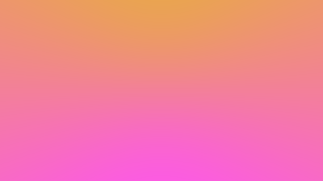
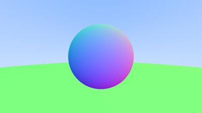
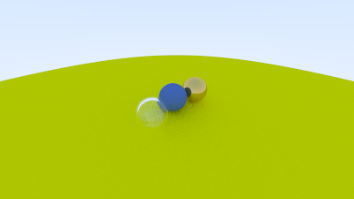
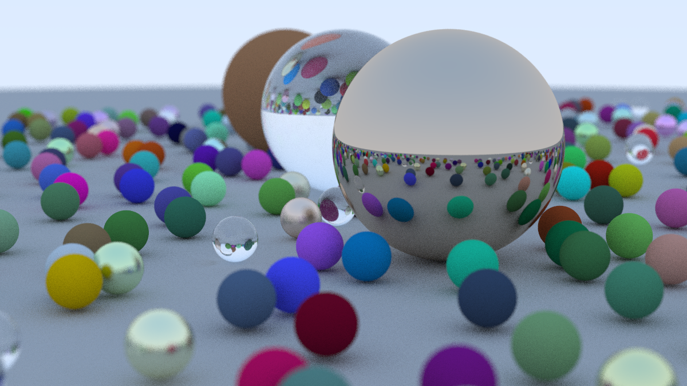
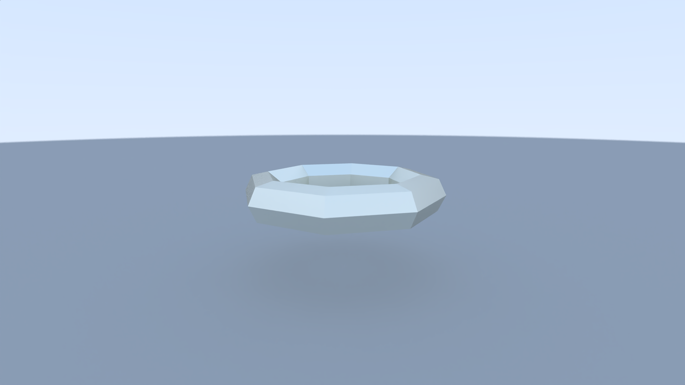
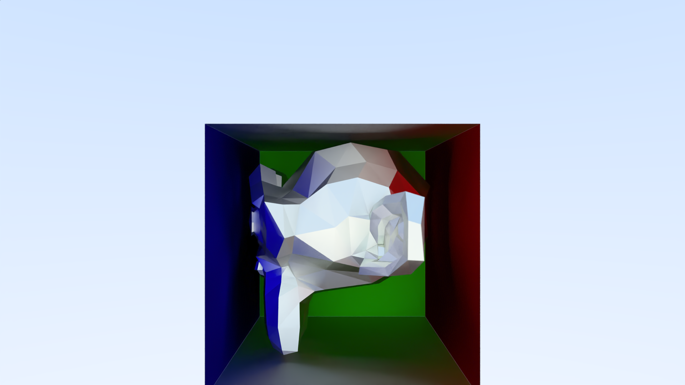
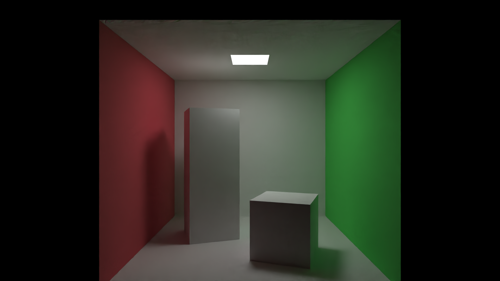

## Raytracing Project

# Intro
I had some time over my summer  in 2026 and wanted to try to create a raytracer as I believed it would be interesting
I was heavily inspired by Sebastian Lague's Projects on Youtube
-https://www.youtube.com/@SebastianLague
I thought it would be something my level and would improve my skills in a new programming language as I was new to C++ when starting the project
Before only working in GDScript, Python and a TINY bit of C#

# Sources and Credits

Started by following "Ray Tracing in One Weekend" by Peter Shirley, Trevor David Black and Steve Hollasch
-This was the main base for the project and was very helpful, I tried to understand the tutorial as I went along
-Title (series): “Ray Tracing in One Weekend Series” Title (book): “Ray Tracing in One Weekend” Author: Peter Shirley, Trevor David Black, Steve Hollasch Version/Edition: v4.0.2 Date: 2025-04-25 URL (series): https://raytracing.github.io -URL (book): https://raytracing.github.io/books/raytracinginoneweekend.html

I then mainly used Google Gemini 3.7 flash to help me learn how to draw triangles and incorperate a JSON scene editor to make adjusting the scene easier
I avoided using GenAI fully to develop, instead asking it for concepts and help on errors that came up

I then read How to build a BVH - Jacco's Blog by Jacco Bikker https://jacco.ompf2.com/2022/04/13/how-to-build-a-bvh-part-1-basics/
-This section was quite challenging to implement but very rewarding as it did create a very visible performance increase

I have since implemented the Intel OpenImageDenoiser as well as a model_loader script to import objs from blender.
-This was the most rewarding part by far, as it was my most custom code and I felt proud of my implementation, it
also allows me to incorporate my hobby of 3D modelling in blender by rendering my own models which is really cool (although still mighty slow)
-The OID was just to make the renders look better, not really hard to implement as it is all basically done for me

# Here are some of my favourite renders:
First PPM:

First Antialiasing

Multiple Materials

Moveable Camera

The Cover Image from "RayTracing in a Weekend"

Adding Models and Denoising

Blender's Suzanne in a Box

The CornelBox
